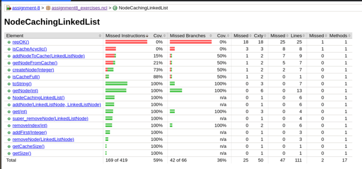
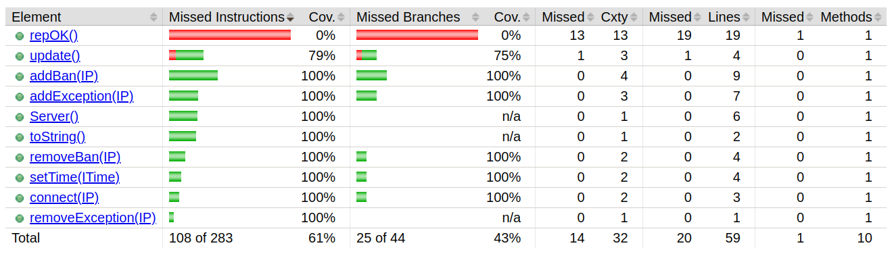
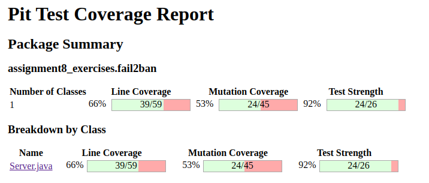
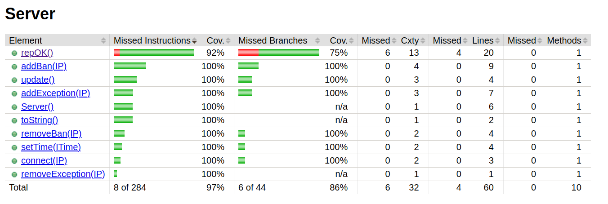
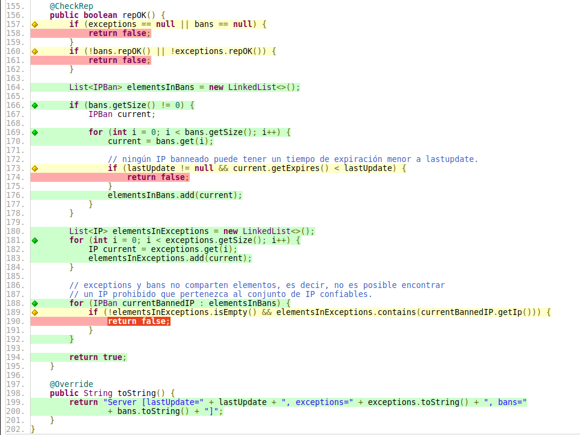

e# Testing de Software 2024 - Práctico 8

## EJERCICIO 1:

### a)

Se generaron Tests con Randoop para la clase `NodeCachingLinkedList` y se obtuvieron los siguientes resultados, dentro de los cuales ningún errorTest fue generado.

```sh
$ [gen-randoop.sh](http://_vscodecontentref_/0) assignment8_exercises.ncl.NodeCachingLinkedList 30

policy = sun.security.provider.PolicyFile@6f496d9f
PUBLIC MEMBERS=10
Explorer = randoop.generation.ForwardGenerator@15615099

Progress update: test inputs generated=0, failing inputs=0      (Fri Oct 25 15:09:09 ART 2024)
Progress update: test inputs generated=1573, failing inputs=0      (Fri Oct 25 15:09:14 ART 2024)
Progress update: test inputs generated=3118, failing inputs=0      (Fri Oct 25 15:09:19 ART 2024)
Progress update: test inputs generated=4508, failing inputs=0      (Fri Oct 25 15:09:24 ART 2024)
Progress update: test inputs generated=5898, failing inputs=0      (Fri Oct 25 15:09:29 ART 2024)
Progress update: test inputs generated=7163, failing inputs=0      (Fri Oct 25 15:09:34 ART 2024)
Progress update: test inputs generated=8405, failing inputs=0      (Fri Oct 25 15:09:39 ART 2024)
Normal method executions:185536
Exceptional method executions:700

Average method execution time (normal termination):      0.147
Average method execution time (exceptional termination): 0.196

No error-revealing tests to output

Regression test output:
Regression test count: 4197
Writing JUnit tests...

Created file: ../assignment-8-balestra-buil-compagnucci/src/test/java/assignment8_exercises/ncl/RegressionTest0.java
Created file: ../assignment-8-balestra-buil-compagnucci/src/test/java/assignment8_exercises/ncl/RegressionTest1.java
Created file: ../assignment-8-balestra-buil-compagnucci/src/test/java/assignment8_exercises/ncl/RegressionTest2.java
Created file: ../assignment-8-balestra-buil-compagnucci/src/test/java/assignment8_exercises/ncl/RegressionTest3.java
Created file: ../assignment-8-balestra-buil-compagnucci/src/test/java/assignment8_exercises/ncl/RegressionTest4.java
Created file: ../assignment-8-balestra-buil-compagnucci/src/test/java/assignment8_exercises/ncl/RegressionTest5.java
Created file: ../assignment-8-balestra-buil-compagnucci/src/test/java/assignment8_exercises/ncl/RegressionTest6.java
Created file: ../assignment-8-balestra-buil-compagnucci/src/test/java/assignment8_exercises/ncl/RegressionTest7.java
Created file: ../assignment-8-balestra-buil-compagnucci/src/test/java/assignment8_exercises/ncl/RegressionTest8.java
Created file: ../assignment-8-balestra-buil-compagnucci/src/test/java/assignment8_exercises/ncl/RegressionTest.java
```

### b)

No fue necesario, en este caso, corregir defectos ya que ninguno fue encontrado en el inciso anterior.

### c)

En este inciso se agregó a la implementación de la clase NodeCachingLinkedList el invariante de representación (repOK). Y se añadió la etiqueta al método @CheckRep. Luego se generaron los tests sobre la misma clase y el resultado obtenido fue el siguiente:

```sh
policy = sun.security.provider.PolicyFile@27f8302d
ANNOTATION: Detected @CheckRep-annotated method "public boolean assignment8_exercises.ncl.NodeCachingLinkedList.repOK()". Will use it to check rep invariant of class assignment8_exercises.ncl.NodeCachingLinkedList during generation.
PUBLIC MEMBERS=9
Explorer = randoop.generation.ForwardGenerator@1888ff2c

Progress update: test inputs generated=0, failing inputs=0      (Thu Oct 31 16:39:03 ART 2024)
Progress update: test inputs generated=529, failing inputs=0      (Thu Oct 31 16:39:08 ART 2024)
Progress update: test inputs generated=1081, failing inputs=0      (Thu Oct 31 16:39:13 ART 2024)
Progress update: test inputs generated=1587, failing inputs=0      (Thu Oct 31 16:39:18 ART 2024)
Progress update: test inputs generated=2129, failing inputs=0      (Thu Oct 31 16:39:23 ART 2024)
Progress update: test inputs generated=2694, failing inputs=0      (Thu Oct 31 16:39:28 ART 2024)
Progress update: test inputs generated=3290, failing inputs=0      (Thu Oct 31 16:39:33 ART 2024)
Normal method executions:67793
Exceptional method executions:394

Average method execution time (normal termination):      0.411
Average method execution time (exceptional termination): 0.604

No error-revealing tests to output

Regression test output:
Regression test count: 1663
Writing JUnit tests...

Created file: ../assignment8_exercises/ncl/RegressionTest0.java
Created file: ../assignment-8-balestra-buil-compagnucci/src/test/java/assignment8_exercises/ncl/RegressionTest1.java
Created file: ../assignment-8-balestra-buil-compagnucci/src/test/java/assignment8_exercises/ncl/RegressionTest2.java
Created file: ../assignment-8-balestra-buil-compagnucci/src/test/java/assignment8_exercises/ncl/RegressionTest3.java
Created file: ../assignment-8-balestra-buil-compagnucci/src/test/java/assignment8_exercises/ncl/RegressionTest.java
```

En esta ejecución de tests, no se identificaron defectos, lo cual se debe a que el invariante de representación (repOk) no es capaz de detectar el error presente en la clase. Este defecto proviene de la falta de inicialización del atributo `maximumCacheSize`, lo que provoca que su valor por defecto sea 0. El método repOk no contempla esta situación, por lo que el defecto pasa inadvertido en las verificaciones actuales.

### d) Medir cobertura de branches y de mutación de la suite de test de regresión obtenida.

Luego de medir cobertura de mutación de la suite de test generada por Randoop, se obtuvo lo siguiente:

```sh
================================================================================
- Statistics
================================================================================
>> Line Coverage: 65/112 (58%)
>> Generated 95 mutations Killed 46 (48%)
>> Mutations with no coverage 43. Test strength 88%
>> Ran 26052 tests (274.23 tests per mutation)
```

Se puede observar un porcentaje de cobertura bastante pobre, en donde se presenta una cobertura de líneas de solo el 58%, indicando que el 42% de líneas de código nunca fueron alcanzadas. Esta baja cobertura sugiere que existen partes de la lógica de la clase que no son testeadas nunca.
Con una tasa del 48%, la suite logra matar menos de la mitad de las mutaciones generadas.

Para medir cobertura de branches se utilizó la herramienta JaCoCo y se obtuvo lo siguiente: (ubicado en el repositorio /images/branchesCoverage.png)



Luego de ejecutar la herramienta, se puede observar un porcentaje de cobertura de un %59.

## EJERCICIO 2:

Luego de generar tests para la clase fileExample se obtuvo lo siguiente:

```sh
$ sh gen-randoop.sh assignment8_exercises.fileContents.fileExample 30
policy = sun.security.provider.PolicyFile@f2a0b8e
PUBLIC MEMBERS=3
Explorer = randoop.generation.ForwardGenerator@7c75222b

Progress update: test inputs generated=0, failing inputs=0      (Fri Nov 01 15:09:00 ART 2024)
Progress update: test inputs generated=3, failing inputs=0      (Fri Nov 01 15:09:10 ART 2024)
Progress update: test inputs generated=3, failing inputs=0      (Fri Nov 01 15:09:15 ART 2024)
Progress update: test inputs generated=3, failing inputs=0      (Fri Nov 01 15:09:20 ART 2024)
Progress update: test inputs generated=3, failing inputs=0      (Fri Nov 01 15:09:25 ART 2024)
Progress update: test inputs generated=3, failing inputs=0      (Fri Nov 01 15:09:30 ART 2024)
Normal method executions:9
Exceptional method executions:1

Average method execution time (normal termination):      0.526
Average method execution time (exceptional termination): 5.00e+03

No error-revealing tests to output
No regression tests to output
```

No se generaron tests ni de regresión ni de error para esta clase con la herramienta Randoop. Eso se debe a que el método `checkContent()` hace uso de la consola para obtener el nombre del archivo con el que comparará más tarde su contenido con la fecha del sistema.

Si ahora modificamos el método `checkContent()` para que no solicite el nombre del archivo por consola, como se muestra a continuación:

```sh
	public boolean checkContent() throws Exception{

		// Scanner console = new Scanner(System.in);
		//String fileName = console.nextLine();
		//console.close();

		String fileName = "hola";

		File file = new File(fileName);
		if(!file.exists())
			return false;

		Scanner fromFile = new Scanner(new FileInputStream(file));
		String fileContent = fromFile.nextLine();
		fromFile.close();
		String date = DateFormat.getDateInstance(DateFormat.SHORT).format(new Date());

		System.out.println(date);
		if(fileContent.equals(date))
			return true;

		return false;

	}
```

Y se vuelven a generar tests con la herramienta Randoop:

```sh
$ ./gen-randoop.sh assignment8_exercises.fileContents.fileExample 20
policy = sun.security.provider.PolicyFile@6f496d9f
PUBLIC MEMBERS=3
Explorer = randoop.generation.ForwardGenerator@1b701da1

Progress update: test inputs generated=0, failing inputs=0      (Fri Nov 01 15:13:43 ART 2024)
Progress update: test inputs generated=101, failing inputs=0      (Fri Nov 01 15:13:48 ART 2024)
Progress update: test inputs generated=101, failing inputs=0      (Fri Nov 01 15:13:53 ART 2024)
Progress update: test inputs generated=101, failing inputs=0      (Fri Nov 01 15:13:58 ART 2024)
Progress update: test inputs generated=101, failing inputs=0      (Fri Nov 01 15:14:03 ART 2024)
Normal method executions:5354
Exceptional method executions:0

Average method execution time (normal termination):      0.220
Average method execution time (exceptional termination): NaN

No error-revealing tests to output

Regression test output:
Regression test count: 1
Writing JUnit tests...

Created file: /home/agustin/Desktop/university/testing/assignmnet-8-balestra-buil-compagnucci/src/test/java/assignment8_exercises/fileContents/RegressionTest0.java
Created file: /home/agustin/Desktop/university/testing/assignmnet-8-balestra-buil-compagnucci/src/test/java/assignment8_exercises/fileContents/RegressionTest.java
```

Obtenemos un único test:

```sh
@Test
  public void test1() throws Throwable {

    if (debug) { System.out.format("%n%s%n","RegressionTest0.test1"); }

    assignment8_exercises.fileContents.fileExample fileExample_instance0 = new assignment8_exercises.fileContents.fileExample();

    boolean b1 = fileExample_instance0.checkContent();
    // más casos como boolean bn = fileExample_instance0.checkContent();

    // Regression assertion (captures the current behavior of the code)

    org.junit.Assert.assertTrue(b1 == false);
    // otros casos como org.junit.Assert.assertTrue(bn == false);

  }
```

En este test, se observa que el mismo comportamiento se repite varias veces con verificaciones idénticas, lo que no es eficiente y evidencia que Randoop requiere un soporte adicional para abordar adecuadamente el problema. Una posible solución sería implementar un mocking manual, permitiendo que Randoop use este recurso para generar tests de forma más adecuada.

Se puede observar a continuación, al generar tests utilizando la herramienta Evosuite, cómo los resultados obtenidos son diferentes, como se puede ver a continuación:

```sh
$ ./gen-evo.sh assignment8_exercises.fileContents.fileExample 20
* Starting evolution
* Initial Number of Goals in DynaMOSA = 12 / 51
[Progress:==============================100%] [Cov:================================>  93%]
* Search finished after 21s and 221 generations, 61776 statements, best individual has fitness: 3.0
* Minimizing test suite
* Going to analyze the coverage criteria
* Coverage analysis for criterion LINE
* Coverage of criterion LINE: 100%
* Total number of goals: 15
* Number of covered goals: 15
* Coverage analysis for criterion BRANCH
* Coverage of criterion BRANCH: 100%
* Total number of goals: 5
* Number of covered goals: 5
* Coverage analysis for criterion EXCEPTION
* Coverage of criterion EXCEPTION: 100%
* Total number of goals: 2
* Number of covered goals: 2
* Coverage analysis for criterion WEAKMUTATION
* Coverage of criterion WEAKMUTATION: 95%
* Total number of goals: 20
* Number of covered goals: 19
* Coverage analysis for criterion OUTPUT
* Coverage of criterion OUTPUT: 100%
* Total number of goals: 2
* Number of covered goals: 2
* Coverage analysis for criterion METHOD
* Coverage of criterion METHOD: 100%
* Total number of goals: 2
* Number of covered goals: 2
* Coverage analysis for criterion METHODNOEXCEPTION
* Coverage of criterion METHODNOEXCEPTION: 100%
* Total number of goals: 2
* Number of covered goals: 2
* Coverage analysis for criterion CBRANCH
* Coverage of criterion CBRANCH: 100%
* Total number of goals: 5
* Number of covered goals: 5
* Generated 5 tests with total length 19
* Resulting test suite's coverage: 93% (average coverage for all fitness functions)
* Generating assertions
* Resulting test suite's mutation score: 80%
* Compiling and checking tests
* Writing tests to file
* Writing JUnit test case 'fileExample_ESTest' to src/test/java
* Writing failing test cases 'fileExample_ESTest' to src/test/java
* Done!

* Computation finished
```

Esta herramienta genera 5 tests para el método `checkContent()` sin ser un problema la forma en la que solicita el
método el nombre del archivo. Esto se debe a que Evosuite genera Mocks para poder testear esta situación.

## Ejercicio 3:

Para mejorar la generación de tests en Randoop en escenarios complejos como el del ejercicio 2, podemos utilizar
algunos de los mecanismos y configuraciones que Randoop nos ofrece. Como por ejemplo:

- Especificación de Métodos y Clases: Podemos personalizar qué métodos y clases Randoop debe considerar en la
  generación de tests. Para especificar métodos que se deban usar en los tests, se utilizan opciones como --classlist,
  que permite listar las clases que se desean incluir en los tests, o --testjar para incluir todos los métodos de las
  clases en un archivo .jar.

- Excluir Métodos y Clases Innecesarios: Se usan opciones como --omit-methods o --omit-classes para evitar que Randoop
  genere tests para métodos que no sean relevantes, como aquellos que interactúan directamente con la consola o el
  sistema de archivos. Esto resulta útil para evitar la inclusión de métodos que pueden causar fallos de ejecución o
  resultados no deterministas.

- Evitando Llamadas a Métodos Específicos (replacecall): Si algunos métodos deben ser reemplazados o simulados para
  que los tests sean más efectivas (como cuando interactúan con el sistema), se puede usar el agente replacecall que
  permite definir reemplazos para métodos específicos.

- Minimización de Casos de Test: Podemos utilizar la opción --minimize-error-test para reducir la complejidad de los
  casos de tests que Randoop identifica errores.
  Esta opción simplifica los errorTests eliminando llamadas irrelevantes, facilitando el análisis y la depuración de
  fallos.

- Uso de Especificaciones (Specifications): Definir especificaciones le permite a Randoop entender mejor el
  comportamiento esperado de los métodos. Puedes usar --specifications para definir un archivo de especificaciones en
  el cual Randoop se base para clasificar los tests como error-revealing o de regression, lo que mejora la precisión de
  los tests generados.

## Ejercicio 5:

### a):

Para la implementación del repOk() de la clase Server, se tuvo en cuenta lo siguiente:

- Se implementó el repOk() de la clase SinglyLinkedList ya que exceptions es una SinglyLinkedList, en esta se comprobó que no tenga repetidos.
- Implementación del repOk() de la clase StrictlySortedSinglyLinkedList ya que la lista bans es una StrictlySortedSinglyLinkedList, en esta se comprobó que esta no tenga elementos repetidos y que a su vez esté estrictamente ordenada con respecto al tiempo de expiración de cada IP.
- En la clase Server en el método repOk() se comprobó que ambas listas bans y exceptions cumplan con su repOk(), que ningún IP banneado tenga un tiempo de expiración menor a lastupdate y que ambas listas no compartan elementos.

### b):

Luego de correr Randoop con un tiempo máximo de 30 segundos utilizando el repOk implementado para la clase Server, se obtuvo lo siguiente:

```sh
policy = sun.security.provider.PolicyFile@6f496d9f
Ignoring interface assignment8_exercises.fail2ban.ITime specified via --classlist or --testclass.
ANNOTATION: Detected @CheckRep-annotated method "public boolean assignment8_exercises.fail2ban.Server.repOK()". Will use it to check rep invariant of class assignment8_exercises.fail2ban.Server during generation.
PUBLIC MEMBERS=36
Explorer = randoop.generation.ForwardGenerator@5e91993f

Progress update: test inputs generated=0, failing inputs=0      (Tue Nov 05 14:57:46 ART 2024)
Progress update: test inputs generated=401, failing inputs=11      (Tue Nov 05 14:57:51 ART 2024)
Progress update: test inputs generated=735, failing inputs=22      (Tue Nov 05 14:57:56 ART 2024)
Progress update: test inputs generated=965, failing inputs=33      (Tue Nov 05 14:58:01 ART 2024)
Progress update: test inputs generated=1161, failing inputs=38      (Tue Nov 05 14:58:06 ART 2024)
Progress update: test inputs generated=1372, failing inputs=45      (Tue Nov 05 14:58:11 ART 2024)
Progress update: test inputs generated=1570, failing inputs=54      (Tue Nov 05 14:58:16 ART 2024)
Progress update: test inputs generated=1571, failing inputs=54      (Tue Nov 05 14:58:16 ART 2024)
Normal method executions:299169
Exceptional method executions:50

Average method execution time (normal termination):      0.0932
Average method execution time (exceptional termination): 0.209

Error-revealing test output:
Error-revealing test count: 54
Writing JUnit tests...

Created file: /home/agustin/Desktop/university/testing/assignmnet-8-balestra-buil-compagnucci/src/test/java/assignment8_exercises/fail2ban/ErrorTest0.java
Created file: /home/agustin/Desktop/university/testing/assignmnet-8-balestra-buil-compagnucci/src/test/java/assignment8_exercises/fail2ban/ErrorTest.java

Regression test output:
Regression test count: 705
Writing JUnit tests...

Created file: /home/agustin/Desktop/university/testing/assignmnet-8-balestra-buil-compagnucci/src/test/java/assignment8_exercises/fail2ban/RegressionTest0.java
Created file: /home/agustin/Desktop/university/testing/assignmnet-8-balestra-buil-compagnucci/src/test/java/assignment8_exercises/fail2ban/RegressionTest1.java
Created file: /home/agustin/Desktop/university/testing/assignmnet-8-balestra-buil-compagnucci/src/test/java/assignment8_exercises/fail2ban/RegressionTest.java
```

Defectos encontrados:

- El método addException(IP ip) de la clase Server lanza un NullPointerException cuando recibe un IP nulo. Esto ocurre porque, antes de añadir la dirección a la lista exceptions, el método intenta verificar si exceptions ya contiene ese IP. Sin embargo, al ser ip nulo, no es posible invocar el método equals para hacer esta comprobación. Además, si exceptions está vacía, el chequeo con equals no se realiza, pero al intentar añadir el IP nulo directamente, se produce nuevamente un error.

- El método addBan(IP ban) de la clase Server lanza un NullPointerException cuando recibe un IP nulo. De la misma manera que en el método mencionado anteriormente, cuando se intenta añadir un IP nuevo se llevan a cabo chequeos sobre el mismo o se intenta acceder a sus atributos provocando una excepción. No existe un control de IP's nulos.

- Él método setTime(ITime time) permite settear un tiempo nulo, lo cual no es correcto.

Estos defectos fueron corregidos en la clase Server realizando los chequeos defensivos necesarios en los respectivos métodos.

Segunda generacion (Despues de arreglar los defectos mencionados anteriormente):

```sh
policy = sun.security.provider.PolicyFile@6f496d9f
Ignoring interface assignment8_exercises.fail2ban.ITime specified via --classlist or --testclass.
ANNOTATION: Detected @CheckRep-annotated method "public boolean assignment8_exercises.fail2ban.Server.repOK()". Will use it to check rep invariant of class assignment8_exercises.fail2ban.Server during generation.
PUBLIC MEMBERS=36
Explorer = randoop.generation.ForwardGenerator@5e91993f

Progress update: test inputs generated=0, failing inputs=0      (Tue Nov 05 15:05:50 ART 2024)
Progress update: test inputs generated=503, failing inputs=1      (Tue Nov 05 15:05:55 ART 2024)
Progress update: test inputs generated=853, failing inputs=2      (Tue Nov 05 15:06:00 ART 2024)
Progress update: test inputs generated=1088, failing inputs=2      (Tue Nov 05 15:06:05 ART 2024)
Progress update: test inputs generated=1364, failing inputs=3      (Tue Nov 05 15:06:10 ART 2024)
Progress update: test inputs generated=1593, failing inputs=3      (Tue Nov 05 15:06:15 ART 2024)
Progress update: test inputs generated=1833, failing inputs=3      (Tue Nov 05 15:06:20 ART 2024)
Normal method executions:307466
Exceptional method executions:95

Average method execution time (normal termination):      0.0905
Average method execution time (exceptional termination): 0.164

Error-revealing test output:
Error-revealing test count: 3
Writing JUnit tests...

Regression test output:
Regression test count: 881
Writing JUnit tests...


```

Luego de hacer esta segunda generación de test, nos dimos cuenta que nuestro invariante de representación (repOK())
presentaba un defecto, que no comprobaba correctamente cuando lastUpdate era null.

Luego, se realizó una tercera ejecución de Randoop:

```sh
./gen-randoop.sh assignment8_exercises.fail2ban.Server 30
policy = sun.security.provider.PolicyFile@27f8302d
Ignoring interface assignment8_exercises.fail2ban.ITime specified via --classlist or --testclass.
ANNOTATION: Detected @CheckRep-annotated method "public boolean assignment8_exercises.fail2ban.Server.repOK()". Will use it to check rep invariant of class assignment8_exercises.fail2ban.Server during generation.
PUBLIC MEMBERS=36
Explorer = randoop.generation.ForwardGenerator@2c8d66b2

Progress update: test inputs generated=0, failing inputs=0      (Fri Nov 08 14:58:40 ART 2024)
Progress update: test inputs generated=501, failing inputs=0      (Fri Nov 08 14:58:45 ART 2024)
Progress update: test inputs generated=784, failing inputs=0      (Fri Nov 08 14:58:50 ART 2024)
Progress update: test inputs generated=1067, failing inputs=0      (Fri Nov 08 14:58:55 ART 2024)
Progress update: test inputs generated=1369, failing inputs=0      (Fri Nov 08 14:59:00 ART 2024)
Progress update: test inputs generated=1590, failing inputs=0      (Fri Nov 08 14:59:05 ART 2024)
Progress update: test inputs generated=1808, failing inputs=0      (Fri Nov 08 14:59:10 ART 2024)
Normal method executions:388208
Exceptional method executions:98

Average method execution time (normal termination):      0.0747
Average method execution time (exceptional termination): 0.147

No error-revealing tests to output

Regression test output:
Regression test count: 889
Writing JUnit tests...

```

En donde no se generaron errorTests!!!.
A continuación, se evaluó la cobertura de ramas (Branch Coverage) y la capacidad de la suite de test generada para detectar mutantes. En cuanto a la cobertura de ramas, JaCoCo generó lo siguiente:



Todos los métodos lograron una cobertura del 100%, excepto los métodos update() y repOk(). Cabe destacar que, antes de evaluar la cobertura de ramas, fue necesario comentar ciertos casos en la suite de test, ya que estos generaban fallas al utilizar la herramienta JaCoCo. Se presenta un ejemplo de los casos comentados:

```sh
org.junit.Assert.assertTrue("'" + str2 + "' != '" + "Server [lastUpdate=1730832301681, exceptions=(), bans={}]"+ "'", str2.equals("Server [lastUpdate=1730832301681, exceptions=(), bans={}]"));
-----------------------------------------------------------
org.junit.Assert.assertTrue(long4 == 1730832301681L);
```

Debido a que el método update utiliza una implementación de time que depende del tiempo del sistema, los tests funcionan al ser generados. Sin embargo, al ejecutarlos posteriormente, el uso del tiempo actual provoca que estos tests sean flakey.

Con respecto a mutation coverage, se obtuvo el siguiente resultado:


```sh
================================================================================
- Statistics
================================================================================
> Line Coverage: 39/59 (66%)
> Generated 45 mutations Killed 24 (53%)
> Mutations with no coverage 19. Test strength 92%
> Ran 1171 tests (26.02 tests per mutation)
```

Se puede observar un porcentaje de cobertura bastante bueno, en donde se presenta una cobertura de líneas del 66%, indicando que el 34% de líneas de código nunca fueron alcanzadas. Una parte de la lógica de la clase Server no son testeadas nunca, como es el método repOK().
Con una tasa del 53%, la suite logra matar más de la mitad de las mutaciones generadas.

### c)

En este inciso se corrió Evosuite con un tiempo máximo de 30 segundos. Se obtuvo lo siguiente:

```sh
[Progress:>                             0%] [Cov:>                                  0%]* Total number of test goals for DYNAMOSA: 271
* Using seed 1731091121312
* Starting evolution
* Initial Number of Goals in DynaMOSA = 65 / 271
[Progress:==============================100%] [Cov:==============================>    87%]
* Search finished after 31s and 701 generations, 385331 statements, best individual has fitness: 27.0
* Minimizing test suite
* Going to analyze the coverage criteria
* Coverage analysis for criterion LINE
* Coverage of criterion LINE: 95%
* Total number of goals: 59
* Number of covered goals: 56
* Coverage analysis for criterion BRANCH
* Coverage of criterion BRANCH: 88%
* Total number of goals: 51
* Number of covered goals: 45
* Coverage analysis for criterion EXCEPTION
* Coverage of criterion EXCEPTION: 100%
* Total number of goals: 3
* Number of covered goals: 3
* Coverage analysis for criterion WEAKMUTATION
* Coverage of criterion WEAKMUTATION: 91%
* Total number of goals: 75
* Number of covered goals: 68
* Coverage analysis for criterion OUTPUT
* Coverage of criterion OUTPUT: 87%
* Total number of goals: 15
* Number of covered goals: 13
* Coverage analysis for criterion METHOD
* Coverage of criterion METHOD: 100%
* Total number of goals: 10
* Number of covered goals: 10
* Coverage analysis for criterion METHODNOEXCEPTION
* Coverage of criterion METHODNOEXCEPTION: 100%
* Total number of goals: 10
* Number of covered goals: 10
* Coverage analysis for criterion CBRANCH
* Coverage of criterion CBRANCH: 88%
* Total number of goals: 51
* Number of covered goals: 45
* Generated 22 tests with total length 94
* Resulting test suite's coverage: 87% (average coverage for all fitness functions)
* Generating assertions
* Resulting test suite's mutation score: 64%
* Compiling and checking tests
* Writing tests to file
* Writing JUnit test case 'Server_ESTest' to src/test/java
* Done!
```

No se generaron ErrorTests. Al evaluar la cobertura de ramas en la suite de test generada, se observa que esta suite alcanza una mayor cobertura en comparación con la obtenida mediante la suite generada con Randoop, alcanzando el 86% de cobertura de branches.



Estas diferencias surgen de los enfoques distintos que ambas herramientas utilizan para generar tests. Randoop hace uso de una técnica aleatoria para crear secuencias de invocaciones a métodos. Este enfoque provoca que Randoop cubra menos ramas, ya que no explora de manera intencional o con conocimiento específico las condiciones presentes en el código.
EvoSuite, por otro lado, utiliza algoritmos genéticos para optimizar la suite de tests y maximizar su cobertura. Es por esto que se puede observar una clara diferencia entre la calidad de las suite de tests y sus porcentajes de cobertura.
Además, podemos visualizar que la herramienta EvoSuite no pudo generar casos en donde el invariante de representación se rompa, como se observa en la siguiente imagen. Esto indica que no se encontraron errores dentro de la implementación de la clase Server que no cumplan con el invariante de representación.



MUTATION COVERAGE - EvoSuite:

```sh
- Coverage analysis for criterion WEAKMUTATION
- Coverage of criterion WEAKMUTATION: 91%
- Total number of goals: 75
- Number of covered goals: 68
```

En cuanto a cobertura de mutación, EvoSuite logró alcanzar un 91% de cobertura sobre los objetivos de mutación. Esto significa que, de los 75 mutantes generados, 68 fueron eliminados exitosamente por la suite de tests. En cambio, Randoop generó 45 mutantes y alcanzó un 53% de efectividad, matando solo 24 de los 45 mutantes. Estos resultados sugieren que EvoSuite es significativamente más efectivo que Randoop para detectar y eliminar mutantes, lo cual podría indicar que la suite de tests generada por EvoSuite es más robusta para encontrar errores o defectos.

### d)

Para depurar la implementación de la clase Server utilizando el método repOk() con EvoSuite, la herramienta de por si puede generar aserciones que incluyen verificaciones del invariante, si es que el método repOk() se encuentra implementado. 
Sin embargo, se podría modificar manualmente los tests generados para incluir llamadas a este método, verificando así que el invariante de representación se mantenga incluso después de combinaciones complejas de llamadas a métodos.
Esta verificación puede realizarse añadiendo repOk() al final de cada test generado por EvoSuite, dado que la cantidad de tests generados no es excesiva. Al ejecutar estos tests, cualquier falla en repOk() revelará posibles defectos en el código relacionados con violaciones de invariantes, ayudando así a identificar y depurar inconsistencias en la implementación de la clase Server.

### e)

Test escrito en el repositorio src/test/java/assignment8_exercises/fail2ban/ServerTest.java