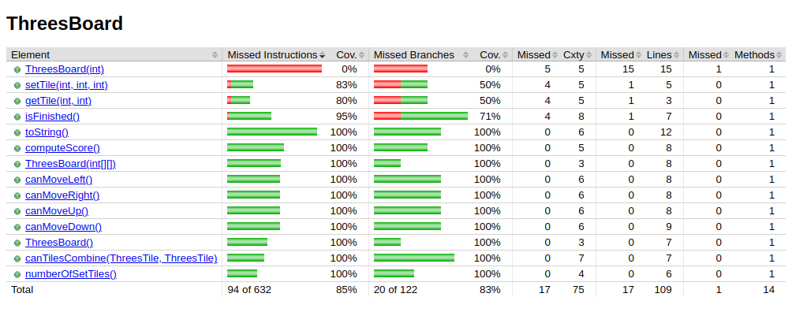
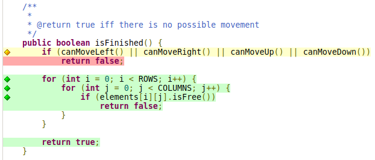
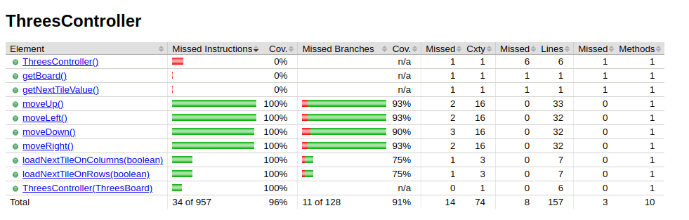

# Trabajo Práctico Final- Documentación

## Ejercicio 1

#### a) Errores en código ya provisto.

- En el metodo `moveDown()` de la clase `ThreesBoardController`

```java
    while (!board.getTile(i, j).isFree())
        i--;
```

Se verifica si la celda está libre, pero no se verifica si i es mayor o igual a 0,
lo que podría causar un `ArrayIndexOutOfBoundsException` si i es menor a 0.

- En el constructor de la clase `ThreesBoard`

```java
    int value = generator.getRandom(3);
```

El método `getRandom()` de la clase `RandomGenerator` devuelve un número entre 0 y n-1,
por lo que el valor de `value` puede ser 0, 1 o 2, pero no 3.
Esto es incorrecto ya que el valor de las celdas en el tablero es 1, 2 o 3.
Para resolver esto, se incrementó en 1 el resultado obtenido por el generador, como se puede observar a continuación:

```java
    int value = generator.getRandom(3) + 1;
```

- En el método `moveDown` de la clase `ThreesController`

```java
if (!mayCombine) {
    int i = ThreesBoard.ROWS - 1;
    while (!board.getTile(i, j).isFree() && i >= 0)
        i--;
    for (int k = i - 1; k >= 0; k--) {
        if (!board.getTile(k, j).isFree())
            movedColumns.add(j);
        board.setTile(k + 1, j, board.getTile(k, j).getValue());
    }
}
```

Hay un problema cuando las baldosas en una columna se mueven hacia abajo para llenar los espacios vacíos. Cuando hay baldosas vacías en una columna, el resto de las baldosas se mueven hacia abajo para ocupar los espacios libres, pero al desplazarlas, nunca se setea en 0 la última baldosa. Esto se puede observar en el siguiente caso: (ilustrado con una sola columna)

```
3
0
0
0
```

al ejecutar `moveDown()`, el resultado obtenido es:

```
3
3
0
0
```

En este ejemplo, la baldosa en la primera fila debe moverse hacia abajo, y luego de moverse, la columna debe quedar libre (0) después de que las demás baldosas se hayan desplazado.

- En el método `moveDown()`:

```java
} else { // combine just once. Here there is no free tile in the middle
    boolean updated = false;
    for (int i = ThreesBoard.ROWS - 1; i > 0 && !updated; i--) {
        if (board.canTilesCombine(board.getTile(i, j), board.getTile(i - 1, j))) {
            // produce first combination
            ThreesTile t = board.getTile(i, j).combineTile(board.getTile(i - 1, j));
            board.setTile(i, j, t.getValue());

            // move anything else to left in the same column
            for (int k = i - 2; k >= 0; k--) {
                board.setTile(k + 1, j, board.getTile(k, j).getValue());
            }
            movedColumns.add(j);
            board.setTile(0, j, 0); // empty the last position
            modified = true;
        }
    }
}
```

Cuando en una columna se presenta la posibilidad de realizar más de una combinación, estas se llevan a cabo, en vez de una sola. Ilustrado con un ejemplo se puede visualizar mejor. Dado el siguiente tablero:

```
3 3 3 3
3 3 3 3
3 3 3 3
3 3 3 3
```

Al ejecutar `moveDown()` se obtiene el siguiente resultado:

```
0 0 1 0
0 0 0 0
6 6 6 6
6 6 6 6
```

Lo cual es incorrecto. El resultado correcto es el siguiente:

```
0 0 1 0
3 3 3 3
3 3 3 3
6 6 6 6
```

Esto se resuelve de manera muy sencilla al settear la variable `updated` en true luego de realizar la primera combinación.

- En el método `moveDown`, más específicamente en el siguiente predicado:

```java
boolean mayCombine = !board.getTile(3, j).isFree() &&
					!board.getTile(2, j).isFree() &&
					!(board.getTile(1, j).isFree() && !board.getTile(0, j).isFree());
```

provoca que se den movimientos incorrectos. Una ilustración de un caso incorrecto se puede visualizar a continuación, dado el siguiente tablero:

```
2 0 0 0 
0 0 0 0 
3 0 0 0 
3 0 0 0 
```

Se obtiene el siguiente luego de ejecutar `moveDown`:

```
1 0 0 0 
2 0 0 0 
3 0 0 0 
3 0 0 0
```
Lo cual es incorrecto, ya que la combinación entre ambas baldosas con valor 3 se deberían haber combinado. El resultado correcto debería ser el siguiente:

```
1 0 0 0 
2 0 0 0 
0 0 0 0 
6 0 0 0
```

Este error se pudo solucionar rápidamente cambiando el predicado de la asignación, como se puede ver a continuación:
```java
boolean mayCombine = !board.getTile(3, j).isFree()
					&& !board.getTile(2, j).isFree()
					&& (board.canTilesCombine(board.getTile(3,j),board.getTile(2,j))
					|| !(board.getTile(1, j).isFree() && !board.getTile(0, j).isFree()));

```


#### Solución a errores:

Los errores identificados en el código fueron corregidos de manera correspondiente para asegurar el correcto funcionamiento del sistema.

### Modelo

Se aplicó el criterio cobertura lógica para modelar los tests del software.

### Criterio de Cobertura

Dentro de los criterios de cobertura lógica, se eligió aplicar el criterio de cobertura RACC.

### Requisitos de Test

#### Método `isFinished()`

Predicados dentro de este método:

##### p1 = canMoveLeft() || canMoveRight() || canMoveUp() || canMoveDown()

Reescribiendo, obtenemos el siguiente predicado: p = a v b v c v d.
Sabemos que para que `a` determine a p se debe cumplir lo siguiente: b = c = d = False. Entonces, los pares de filas que satisfacen el criterio RACC para la cláusula son los siguientes:

| `a` | `b` | `c` | `d` | `(a ∨ b ∨ c ∨ d)` |
| --- | --- | --- | --- | ----------------- |
| 1   | 0   | 0   | 0   | 1                 |
| 0   | 0   | 0   | 0   | 0                 |

Para que `b` determine a p se debe cumplir lo siguiente: a = c = d = False. Entonces, los pares de filas que satisfacen el criterio RACC para la cláusula son los siguientes:

| `a` | `b` | `c` | `d` | `(a ∨ b ∨ c ∨ d)` |
| --- | --- | --- | --- | ----------------- |
| 0   | 1   | 0   | 0   | 1                 |
| 0   | 0   | 0   | 0   | 0                 |

Para que `c` determine a p se debe cumplir lo siguiente: a = b = d = False. Entonces, los pares de filas que satisfacen el criterio RACC para la cláusula son los siguientes:

| `a` | `b` | `c` | `d` | `(a ∨ b ∨ c ∨ d)` |
| --- | --- | --- | --- | ----------------- |
| 0   | 0   | 1   | 0   | 1                 |
| 0   | 0   | 0   | 0   | 0                 |

Para que `d` determine a p se debe cumplir lo siguiente: a = b = c = False. Entonces, los pares de filas que satisfacen el criterio RACC para la cláusula son los siguientes:

| `a` | `b` | `c` | `d` | `(a ∨ b ∨ c ∨ d)` |
| --- | --- | --- | --- | ----------------- |
| 0   | 0   | 0   | 1   | 1                 |
| 0   | 0   | 0   | 0   | 0                 |

En conclusión, los requistos de test que satisfacen el criterio RACC para el predicado p1 son {TFFF, FFFF, FTFF, FFTF, FFFT}.

#### Requisitos inviables:

- a = T, b = F, c = F y d = F para el predicado p1.

Este requisito implica que el único movimiento posible en el tablero es hacia la izquierda. Sin embargo, en Threes, cualquier situación que permita mover una ficha hacia la izquierda también posibilitará movimientos en otras direcciones. Esto se debe a que, para que un movimiento hacia la izquierda sea viable, debe haber dos fichas adyacentes combinables o un espacio vacío a la izquierda de alguna ficha. Ambos casos generan también movimientos posibles en direcciones adicionales, lo cual imposibilita cumplir con la restricción de solo un movimiento hacia la izquierda.
En el caso de contar con dos baldosas combinables, estas se podrán combinar moviendo en ambas direcciones. Supongamos que tenemos la disposición `2 3 3`. En este caso, los dos 3's pueden combinarse si se mueve el 3 en el borde hacia la izquierda. Sin embargo, también se podría combinar moviendo el 3 central hacia la derecha, permitiendo un movimiento adicional en otra dirección.

En el caso en que se tenga una baldosa libre, como el siguiente ejemplo:

```sh
1 3 6 6
0 1 3 2
0 0 0 0
0 0 0 0
```

La baldosa 1 en la segunda fila podría moverse hacia la izquierda para ocupar el espacio vacío (0). Sin embargo, este no es el único movimiento posible, ya que también se puede mover la baldosa 1 en la fila superior hacia abajo, ocupando igualmente el espacio vacío.

Esta misma lógica se aplica a los demás requisitos inviables (FTFF, FFTF, y FFFT), que implican que solo es posible un movimiento en una dirección específica. En un tablero de Threes, cualquier situación que permita un movimiento en una sola dirección generará, de forma inherente, posibles movimientos en otras direcciones también, haciendo imposible que el tablero permita solo un único movimiento direccional.

##### p2 = i < ROWS

##### p3 = j < COLUMNS

##### p4 = elements[i][j].isFree()

Reescribiendo, obtenemos el siguiente predicado: p = a. Observando su tabla de verdad:

| `a` |
| --- |
| 1   |
| 0   |

Se concluye que los requisitos de test que satisfacen el crierio RACC para los predicados p2, p3 y p4 son: {T, F}

#### método `canTilesCombine()`

Predicados dentro de este método:

##### p1 = t1.getValue() >= 3 && t1.getValue() == t2.getValue()

##### p2 = t1.getValue() == 1 && t2.getValue() == 2

##### p3 = t2.getValue() == 1 && t1.getValue() == 2

Reescribiendo, obtenemos el siguiente predicado: p = a ∧ b. Observando su tabla de verdad:

| `a` | `b` | `a ∧ b` |
| --- | --- | ------- |
| 1   | 1   | 1       |
| 1   | 0   | 0       |
| 0   | 1   | 0       |
| 0   | 0   | 0       |

Sabemos que para que `a` determine a al predicado p se debe cumplir: b = True. Entonces, los pares de filas que satisfacen el criterio RACC para la cláusula `a` son los siguientes:

| `a` | `b` | `a ∧ b` |
| --- | --- | ------- |
| 1   | 1   | 1       |
| 0   | 1   | 0       |

Para que `b` determine a al predicado p se debe cumplir: a = True. Entonces, los pares de filas que satisfacen el criterio RACC para la cláusula `b` son los siguientes:

| `a` | `b` | `a ∧ b` |
| --- | --- | ------- |
| 1   | 1   | 1       |
| 1   | 0   | 0       |

Se concluye que los requisitos de test que satisfacen el crierio RACC para los predicados p1, p2 y p3 son: {TT, FT, TF}.

#### método `canMoveUp()`

Predicados dentro de este método:

##### p1 = row < ROWS

##### p2 = col < COLUMNS

Reescribiendo, obtenemos el siguiente predicado: p = a. Observando su tabla de verdad:

| `a` |
| --- |
| 1   |
| 0   |

Se concluye que los requisitos de test que satisfacen el crierio RACC para los predicados p1 y p2 son: {T, F}

##### p3 = canTilesCombine(tileAbove, currentTile) || (!currentTile.isFree() && tileAbove.isFree())

Reescribiendo, obtenemos el siguiente predicado: p = a v (!b ∧ c).
Sabemos que para que la cláusula `a` determine el predicado p, ese necesario que se cumpla lo siguiente: (!b ∧ c) = False. Entonces, los pares de filas que satisfacen el criterio RACC para la cláusula `a` son los siguientes:

| `a` | `b` | `c` | `!b` | `!b ∧ c` | `a ∨ (!b ∧ c)` |
| --- | --- | --- | ---- | -------- | -------------- |
| 1   | 1   | 1   | 0    | 0        | 1              |
| 1   | 1   | 0   | 0    | 0        | 1              |
| 1   | 0   | 0   | 1    | 0        | 1              |
| 0   | 1   | 1   | 0    | 0        | 0              |
| 0   | 1   | 0   | 0    | 0        | 0              |
| 0   | 0   | 0   | 1    | 0        | 0              |

Para que la cláusula `b` determine el predicado p, ese necesario que se cumpla lo siguiente: a = False y c = True. Entonces, los pares de filas que satisfacen el criterio RACC para la cláusula `b` son los siguientes:

| `a` | `b` | `c` | `!b` | `!b ∧ c` | `a ∨ (!b ∧ c)` |
| --- | --- | --- | ---- | -------- | -------------- |
| 0   | 1   | 1   | 0    | 0        | 0              |
| 0   | 0   | 1   | 1    | 1        | 1              |

Para que la cláusula `c` determine el predicado p, ese necesario que se cumpla lo siguiente: a = False y b = False. Entonces, los pares de filas que satisfacen el criterio RACC para la cláusula `c` son los siguientes:

| `a` | `b` | `c` | `!b` | `!b ∧ c` | `a ∨ (!b ∧ c)` |
| --- | --- | --- | ---- | -------- | -------------- |
| 0   | 0   | 1   | 1    | 1        | 1              |
| 0   | 0   | 0   | 1    | 0        | 0              |

Se concluye, entonces, que los requisitos de test que satisfacen el crierio RACC para el preidcado p3 son: {TTT, FTT, TTF, FTF, TFF, FFF, FFT}.

#### método `canMoveDown()`

Predicados dentro de este método:

##### p1 = row < ROWS - 1

##### p2 = col < COLUMNS

Reescribiendo, obtenemos el siguiente predicado: p = a. Observando su tabla de verdad:

| `a` |
| --- |
| 1   |
| 0   |

Se concluye que los requisitos de test que satisfacen el crierio RACC son: {T, F}

##### p3 = canTilesCombine(currentTile, tileDown) || !currentTile.isFree() && tileDown.isFree()

Reescribiendo, obtenemos el siguiente predicado: p = a v (!b ∧ c).

Sabemos que para que la cláusula `a` determine el predicado p, ese necesario que se cumpla lo siguiente: (!b ∧ c) = False. Entonces, los pares de filas que satisfacen el criterio RACC para la cláusula `a` son los siguientes:

| `a` | `b` | `c` | `!b` | `!b ∧ c` | `a ∨ (!b ∧ c)` |
| --- | --- | --- | ---- | -------- | -------------- |
| 1   | 1   | 1   | 0    | 0        | 1              |
| 1   | 1   | 0   | 0    | 0        | 1              |
| 1   | 0   | 0   | 1    | 0        | 1              |
| 0   | 1   | 1   | 0    | 0        | 0              |
| 0   | 1   | 0   | 0    | 0        | 0              |
| 0   | 0   | 0   | 1    | 0        | 0              |

Para que la cláusula `b` determine el predicado p, ese necesario que se cumpla lo siguiente: a = False y c = True. Entonces, los pares de filas que satisfacen el criterio RACC para la cláusula `b` son los siguientes:

| `a` | `b` | `c` | `!b` | `!b ∧ c` | `a ∨ (!b ∧ c)` |
| --- | --- | --- | ---- | -------- | -------------- |
| 0   | 1   | 1   | 0    | 0        | 0              |
| 0   | 0   | 1   | 1    | 1        | 1              |

Para que la cláusula `c` determine el predicado p, ese necesario que se cumpla lo siguiente: a = False y b = False. Entonces, los pares de filas que satisfacen el criterio RACC para la cláusula `c` son los siguientes:

| `a` | `b` | `c` | `!b` | `!b ∧ c` | `a ∨ (!b ∧ c)` |
| --- | --- | --- | ---- | -------- | -------------- |
| 0   | 0   | 1   | 1    | 1        | 1              |
| 0   | 0   | 0   | 1    | 0        | 0              |

Se concluye que los requisitos de test que satisfacen el crierio RACC para el predicado p3 son: {FFF, TFF, FTF, TTF, FTT, TTT, FFT}

#### método `canMoveRight()`

Predicados dentro de este método:

##### p1 = row < ROWS

##### p2 = col < COLUMNS - 1

Reescribiendo ambos predicados, obtenemos el siguiente predicado: p = a. Observando su tabla de verdad:

| `a` |
| --- |
| 1   |
| 0   |

Se concluye que los requisitos de test que satisfacen el crierio RACC son: {T, F}

##### p3 = canTilesCombine(currentTile, tileRight) || (!currentTile.isFree() && tileRight.isFree())

Las cláusulas que componen este predicado son las siguientes:

- a = canTilesCombine(currentTile, tileRight)
- b = !currentTile.isFree()
- c = tileRight.isFree()

Reescribiendo, obtenemos el siguiente predicado: p = a v (!b ∧ c). Observando su tabla de verdad:

| `a` | `b` | `c` | `!b` | `!b ∧ c` | `a ∨ (!b ∧ c)` |
| --- | --- | --- | ---- | -------- | -------------- |
| 0   | 0   | 0   | 1    | 0        | 0              |
| 0   | 0   | 1   | 1    | 1        | 1              |
| 0   | 1   | 0   | 0    | 0        | 0              |
| 0   | 1   | 1   | 0    | 0        | 0              |
| 1   | 0   | 0   | 1    | 0        | 1              |
| 1   | 0   | 1   | 1    | 1        | 1              |
| 1   | 1   | 0   | 0    | 0        | 1              |
| 1   | 1   | 1   | 0    | 0        | 1              |

Para que `a` determine a p se debe cumplir lo siguiente: (!b ∧ c) = False.
Entonces, los pares de filas que satisfacen el criterio RACC para la cláusula `a` son los siguientes:

| `a` | `b` | `c` | `!b` | `!b ∧ c` | `a ∨ (!b ∧ c)` |
| --- | --- | --- | ---- | -------- | -------------- |
| 0   | 1   | 1   | 0    | 0        | 0              |
| 1   | 1   | 1   | 0    | 0        | 1              |
| 0   | 1   | 0   | 0    | 0        | 0              |
| 1   | 1   | 0   | 0    | 0        | 1              |
| 0   | 0   | 0   | 1    | 0        | 0              |
| 1   | 0   | 0   | 1    | 0        | 1              |

Para que `b` determine a p se debe cumplir lo siguiente: a = False y c = True.

Entonces, los pares de filas que satisfacen el criterio RACC para la cláusula `b` son los siguientes:

| `a` | `b` | `c` | `!b` | `!b ∧ c` | `a ∨ (!b ∧ c)` |
| --- | --- | --- | ---- | -------- | -------------- |
| 0   | 0   | 1   | 1    | 1        | 1              |
| 0   | 1   | 1   | 0    | 0        | 0              |

Para que `c` determine a p se debe cumplir lo siguiente: a = False y b = False.

Entonces, los pares de filas que satisfacen el criterio RACC para la cláusula `c` son los siguientes:

| `a` | `b` | `c` | `!b` | `!b ∧ c` | `a ∨ (!b ∧ c)` |
| --- | --- | --- | ---- | -------- | -------------- |
| 0   | 0   | 0   | 1    | 0        | 0              |
| 0   | 0   | 1   | 1    | 1        | 1              |

Se concluye que los requisitos de test que satisfacen el crierio RACC para el predicado p3 son: {FTT, TTT, FTF, TTF, FFF, TFF, FFT}

#### método `canMoveLeft()`

Los predicados en este método son los siguientes:

##### p1 = row < ROWS

##### p2 = col < COLUMNS

##### p3 = canTilesCombine(leftTile, currentTile) || (!currentTile.isFree() && leftTile.isFree())

Las cláusulas que componen p3 son:

- a = canTilesCombine(leftTile, currentTile)
- b = !currentTile.isFree()
- c = leftTile.isFree()

Reescribiendo los tres predicados, obtenemos: p = a v (!b ∧ c).

El proceso es idéntico al de `canMoveRight()`, ya que la lógica de las cláusulas es la misma.
Por lo tanto, las combinaciones de filas que satisfacen el criterio RACC para el método `canMoveLeft()` son las
mismas que para `canMoveRight()`:

- a: {FFF, TFF, FTF, TTF, TFF, FFF}
- b: {FFT, FTT}
- c: {FFF, FFT}

Esto asegura que ambas funciones cubren todas las combinaciones necesarias para las cláusulas en sus predicados.

#### Requisitos inviables:

- a = T, b = T y c = T para el predicado p3 en los métodos `canMoveRight`, `canMoveLeft`, `canMoveUp` y `canMoveDown`.

La cláusuala `a` implica que ambas baldosas pueden combinarse, lo cual requiere que tengan valores distinto de cero. Sin embargo, las cláusulas `b` y `c` indican que tanto `currentTile` como `tileAbove` están libres, lo cual hace imposible su combinación, ya que dos baldosas vacías no pueden combinarse. Por lo tanto, esta combinación de valores es inviable.

Para el mismo predicado, existe otro requisito inviable que se presenta también en los cuatro métodos mencionados anteriormente. Este es: a = T, b = T y c = F. En este caso sucede algo parecido, la cláusula `a` al ser verdadera indica que ambas baldosas se pueden combinar, pero la cláusula `b` implica que la baldosa `currentTile` está vacía. Ambas casos no pueden darse al mismo tiempo.

### método `computeScore()`

Los predicados en este método son los siguientes:

##### p1 = row < ROWS

##### p2 = col < COLUMNS

##### p3 = elements[i][j].getValue() == 3

##### p4 = elements[i][j].getValue() > 3

Reescribiendo, obtenemos el siguiente predicado: p = a. Observando su tabla de verdad:

| `a` |
| --- |
| 0   |
| 1   |

Se concluye que los requisitos de test que satisfacen el crierio RACC son: {T, F}

#### método `numberOfSetTiles()`

Los predicados en este método son los siguientes:

##### p1 = row < ROWS

##### p2 = col < COLUMNS

Reescribiendo, obtenemos el siguiente predicado: p = a. Observando su tabla de verdad:

| `a` |
| --- |
| 0   |
| 1   |

Se concluye que los requisitos de test que satisfacen el crierio RACC son: {T, F}

##### p3 = !elements[i][j].isFree()

Reescribiendo, obtenemos el siguiente predicado: p = !a, donde a = elements[i][j].isFree().
Observando su tabla de verdad:

| `a` | `!a` |
| --- | ---- |
| 0   | 1    |
| 1   | 0    |

Se concluye que los requisitos de test que satisfacen el crierio RACC son: {F, T}

No hay requisitos inviables detectados en el método `numberOfSetTiles()`, lo que indica que todas las combinaciones de valores de los predicados son alcanzables y pueden evaluarse en tests.

### Medición de cobertura usando `JaCoCo`

Luego de implementar la suite de tests siguiendo el criterio de cobertura de predicados (RACC), se utilizó JaCoCo para analizar la cobertura alcanzada. En los resultados obtenidos:



Se observa un 100% de cobertura en todos los métodos evaluados, excepto en el método `isFinished`, que presenta un 95% de cobertura. La razón de esta cobertura incompleta en `isFinished` es la falta de un test que haga verdadero el predicado compuesto en la siguiente condición:

`canMoveLeft() || canMoveRight() || canMoveUp() || canMoveDown()`.



Para obtener el 100% de cobertura en este método, sería necesario cubrir tanto el caso donde este predicado se evalúa en true como cuando se evalúa en false. Sin embargo, al aplicar el criterio RACC, los requisitos de test especifican las siguientes combinaciones en la disyunción: {TFFF, FTFF, FFTF, FFFT}. Estas combinaciones implican que solo uno de los movimientos posibles sea true y los demás false, lo cual resulta en requisitos de test inviables, como ya se mencionó anteriormente.

En otras palabras, no es posible generar un caso de test que cumpla con el criterio RACC y al mismo tiempo haga que todo el predicado se evalúe como true, ya que ello requeriría que al menos dos de los sub-predicados sean true. Esta limitación impide alcanzar el 100% de cobertura para el método `isFinished` bajo los requisitos establecidos.

El resto de los métodos presentan una cobertura de ramas del 100%, esto se debe a que cada decisión y cada caso son evaluados en ambas direcciones (true o false), asegurando una cobertura completa en cada ruta ejecutable del código. Como JaCoCo evalúa cobertura de ramas, lo cual es equivalente a cobertura de predicados, es esperado que la suite de test alcance un 100% en lo que es la cobertura de Predicados, porque para implementarla, se utilizó el criterio RACC, el cual subsume a este criterio.

---

## Ejercicio 2

Se aplicará cobertura de predicados para implementar una suite de test de módulo/integración de alta cobertura.
Este criterio se aplicará a los métodos: `moveUp()`, `moveDown()`, `moveLeft()` y `moveRight()`.

### método `moveUp()`

Los predicados en este método son los siguientes:

p1 = !board.canMoveUp()

p2 = j < ThreesBoard.COLUMNS

p3 = !board.getTile(0, j).isFree()
					&& !board.getTile(1, j).isFree()
					&& (board.canTilesCombine(board.getTile(0, j), board.getTile(1, j))
					|| !(board.getTile(2, j).isFree() && !board.getTile(3, j).isFree()))

p4 = i < ThreesBoard.ROWS && !board.getTile(i, j).isFree()

p5 = k < ThreesBoard.ROWS

p6 = !board.getTile(k, j).isFree()

p7 = i < ThreesBoard.ROWS - 1 && !updated

p8 = board.canTilesCombine(board.getTile(i, j), board.getTile(i + 1, j))

p9 = k < ThreesBoard.ROWS

Reescribiendo cada uno de los predicados, obtenemos:

p1 = !a

p2 = a

p3 = !(!a && !b && !(c && !d))

p4 = !a && b

p5 = a

p6 = !a

p7 = a && !b

p8 = a

p9 = a

Por lo tanto, para el método `moveUp()`, obtenemos el siguiente conjunto de predicados:

P = {p1, p2, p3, p4, p5, p6, p7, p8, p9}

El criterio de cobertura, dice lo siguiente:

Predicate Coverage (PC) : Para cada p de P, RT contiene dos
requisitos: p evalúa a true y p evalúa a false.

Luego, los requisitos de test para el método `moveUp()` son los siguientes:
RT = {p1T, p1F, p2T, p2F, p3T, p3F, p4T, p4F, p5T, p5F, p6T, p6F, p7T, p7F, p8T, p8F, p9T, p9F}


### método `moveDown()`

Los predicados en este método son los siguientes:

p1 = !board.canMoveDown()

p2 = j < ThreesBoard.COLUMNS

p3 = !board.getTile(3, j).isFree()
					&& !board.getTile(2, j).isFree()
					&& (board.canTilesCombine(board.getTile(3,j),board.getTile(2,j))
					|| !(board.getTile(1, j).isFree() && !board.getTile(0, j).isFree()))

p4 = !board.getTile(i, j).isFree() && i >= 0

p5 = k >= 0

p6 = !board.getTile(k, j).isFree()

p7 = i > 0 && !updated

p8 = board.canTilesCombine(board.getTile(i, j), board.getTile(i - 1, j))

p9 =  k >= 0

Reescribiendo cada uno de los predicados, obtenemos:

p1 = !a

p2 = a

p3 = !(!a && !b && !(c && !d))

p4 = !a && b

p5 = a

p6 = !a

p7 = a && !b

p8 = a

p9 = a

Por lo tanto, para el método `moveDown()`, obtenemos el siguiente conjunto de predicados:

P = {p1, p2, p3, p4, p5, p6, p7, p8, p9}

Los requisitos de test para el método `moveDown()` son los siguientes:
RT = {p1T, p1F, p2T, p2F, p3T, p3F, p4T, p4F, p5T, p5F, p6T, p6F, p7T, p7F, p8T, p8F, p9T, p9F}


### método `moveLeft()`

Los predicados en este método son los siguientes:

p1 = !board.canMoveLeft()

p2 = i < ThreesBoard.ROWS

p3 = !board.getTile(i, 0).isFree() &&
								!board.getTile(i, 1).isFree() &&
								(board.canTilesCombine(board.getTile(i,0),board.getTile(i,1)) || !(board.getTile(i, 2).isFree() && !board.getTile(i, 3).isFree()))

p4 = !board.getTile(i, j).isFree() && j < ThreesBoard.COLUMNS

p5 = k < ThreesBoard.COLUMNS

p6 = !board.getTile(i, k).isFree()

p7 = j < ThreesBoard.COLUMNS - 1 && !update

p8 = board.canTilesCombine(board.getTile(i, j), board.getTile(i, j + 1))

p9 = k < ThreesBoard.COLUMNS

Reescribiendo cada uno de los predicados, obtenemos:

p1 = !a

p2 = a

p3 = !(!a && !b && !(c && !d))

p4 = !a && b

p5 = a

p6 = !a

p7 = a && !b

p8 = a

p9 = a

Por lo tanto, para el método `moveLeft()`, obtenemos el siguiente conjunto de predicados:

P = {p1, p2, p3, p4, p5, p6, p7, p8, p9}

Luego, los requisitos de test para el método `moveLeft()` son los siguientes:

RT = {p1T, p1F, p2T, p2F, p3T, p3F, p4T, p4F, p5T, p5F, p6T, p6F, p7T, p7F, p8T, p8F, p9T, p9F}

### método `moveRight()`

Predicados dentro de este método:

p1: !board.canMoveRight()  

p2: i < ThreesBoard.ROWS  

p3: !board.getTile(i, 3).isFree() &&
					!board.getTile(i, 2).isFree() &&
					(board.canTilesCombine(board.getTile(i,3),board.getTile(i,2)) || !(board.getTile(i, 1).isFree() && !board.getTile(i, 0).isFree()))

p4: !board.getTile(i, j).isFree() && j >= 0  

p5: k >= 0  

p6: !board.getTile(i, k).isFree()  

p7: j > 0 && !updated  

p8: board.canTilesCombine(board.getTile(i, j), board.getTile(i, j - 1))  

p9: k >= 0

Para cada predicado pi, los requisitos de test son los siguientes: pi evalúa a True y pi evalúa a False.
Reescribiendo cada uno de los predicados, obtenemos:

p1 = !a

p2 = a

p3 = !(!a && !b && !(c && !d))

p4 = !a && b

p5 = a

p6 = !a

p7 = a && !b

p8 = a

p9 = a

Por lo tanto, para el método `moveRight()`, obtenemos el siguiente conjunto de predicados:

P = {p1, p2, p3, p4, p5, p6, p7, p8, p9}

Luego, los requisitos de test para el método `moveRight()` son los siguientes:
RT = {p1T, p1F, p2T, p2F, p3T, p3F, p4T, p4F, p5T, p5F, p6T, p6F, p7T, p7F, p8T, p8F, p9T, p9F}

### Medición de cobertura usando `JaCoCo`

Luego de implementar la suite de tests siguiendo el criterio de cobertura de predicados, se utilizó JaCoCo para 
analizar la cobertura alcanzada. Los resultados obtenidos son los siguientes:



Como se puede observar, se alcanzó una alta cobertura en todos los métodos evaluados (`moveUp`, `moveDown`,`moveRight`, 
`moveLeft`), esto indica que la suite de tests cubre todas las rutas lógicas, o ramas, en cada uno de estos métodos. 
Al aplicar el criterio de cobertura de predicados, y no haber obtenido ningún requisito inviable, cada predicado fue 
evaluado tanto en su valor verdadero como falso.
Cada combinación posible de condiciones internas ha sido evaluada exhaustivamente, lo que garantiza que el código 
responde correctamente ante diferentes situaciones y no deja comportamientos sin probar.
En este contexto, la cobertura completa de ramas en JaCoCo refleja la implementación completa del criterio de cobertura 
de predicados, ya que ambas cubren todas las decisiones y resultados de predicados dentro de los métodos evaluados.